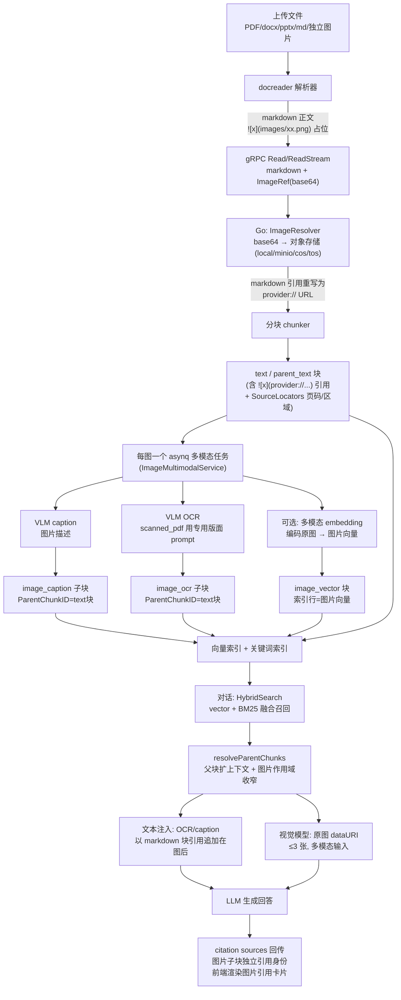

# WeKnora 图片解析与对话使用链路分析

> 依据文档：
> - [文档解析服务 docreader](https://weknora.weixin.qq.com/docs/03-features/03-document-parsing)
> - [知识库与知识管理](https://weknora.weixin.qq.com/docs/03-features/02-knowledge-base)
>
> 并逐条对照 `WeKnora-sync_v0.8.3_base` 仓库源码核实（v0.8.3）。
> 生成日期：2026-10-23

核心结论一句话：**docreader（Python gRPC 服务）只负责把文档里的图片"抠出来"并以 base64 内联回传，完全不做 OCR/VLM；真正的图片理解（OCR 识别文字、VLM 描述、图片向量）全部发生在 Go 主服务入库阶段，产物是挂在文本父块下的 `image_ocr` / `image_caption` / `image_vector` 子分块；对话阶段再通过混合检索召回这些子分块，把 OCR/caption 当作**文本**注入 LLM 上下文，并在对话模型支持视觉时把**原图本身**作为多模态消息一并送进模型。**

---

## 1. 全链路总览



分工边界（文档原话）：

> docreader 是独立的 Python gRPC 服务，负责将文件或 URL 转换为 Markdown 和原始图片引用。Go 主服务随后完成分块、图片存储、OCR、图片描述及向量化。

---

## 2. 第一阶段：docreader 如何"抠"出图片

docreader 对图片的契约极简（`docreader/models/document.py` 的 `BaseParser` 注释明确"轻量化重构后，BaseParser 只抽取 markdown 文本与原始图片引用，分块、图片存储、OCR、VLM caption 由 Go App 负责"）：

```python
class Document(BaseModel):
    content: str                 # markdown 正文，图片以  占位
    images: Dict[str, str]       # {"images/xx.jpg": "<base64>"}
    source_blocks: List[Dict]    # markdown 区间 → 原文位置 (pdf: page+bbox)
    metadata: Dict[str, Any]     # 关键键: image_source_type
```

gRPC 回传有两条路径（`docreader/main.py`）：

- unary `Read`：`_resolve_images()` 把全部图片 base64 解码为 `ImageRef.image_data` 内联字节一次返回；
- 流式 `ReadStream`：`_iter_image_refs()` 帧 1 发 meta，之后每帧 1 张图，服务端边发边 `pop` 释放内存——解决大扫描件 PDF（数百页图）撞 gRPC 消息大小上限（`RESOURCE_EXHAUSTED`）和峰值内存问题。Go 侧 `grpc_parser.go` 默认走 `ReadStream`，旧版 docreader 返回 `Unimplemented` 时自动回退 unary `Read`。

注意：proto 中原来的 `image_storage` 字段已 `reserved`，**图片持久化完全由 Go App 负责**（local/minio/cos/tos），docreader 从不写盘。

### 2.1 各格式的图片提取路径

所有形态的图片最终归一为「markdown 相对路径引用 + base64 dict」，差异只在 metadata 的 `image_source_type`，它决定 Go 侧用哪套 OCR 提示词：

| 来源 | 解析器/文件 | 图片行为 |
|---|---|---|
| PDF（文本+扫描混合） | `parser/pdf_parser.py::PDFParser`（builtin 引擎） | **逐页路由**三 Pass，见 2.2 |
| PDF（纯扫描兜底） | `PDFScannedParser` | 全页渲染 JPEG，正文纯图片占位，`image_source_type=scanned_pdf`；`pdf_force_scanned` 强制走这里，主解析任何异常也回退它 |
| DOCX | `parser/docx_parser.py`（Docx2Parser 回退链） | `a:blip/@r:embed` → related_part blob → PIL，跳过 <50px 装饰图、>1920px 缩放，图片 base64 进 `images`，与文本保持原始顺序 |
| 老式 DOC | `parser/doc_parser.py` | 先 LibreOffice 转 docx（唯一能提图的路径），再走 docx 链 |
| PPT/PPTX | `parser/markitdown_parser.py` + `pptx_media.py` | MarkItDown 出 markdown；WMF/EMF/SVG 等无法内联的媒体由 `pptx_media.py` 解包 `ppt/media/`，Pillow（位图）或 ImageMagick `convert`（矢量）栅格化为 PNG 后回补引用 |
| Markdown | `parser/markdown_parser.py::MarkdownImageBase64` | 把 `data:image/...;base64,` 内联图抽出成 `images/<uuid>.<ext>` 引用 + base64 dict |
| 网页 URL | `parser/web_parser.py`（Playwright+trafilatura） | 正文中的远程 `` 转 markdown 引用；**图片字节由 Go 侧 `image_resolver.go` 带 SSRF 校验补齐下载**（适配微信公众号无扩展名图片等） |
| 静态 HTML 文件 | `parser/html_parser.py` | 同上，`` 远程图由 Go 侧转存 |
| MHTML 归档 | `parser/mhtml_parser.py` | 按 `image/*` MIME part 抽取，`Content-Location`/`cid:`/`X-Attachment-Id` 多拼写匹配 |
| **独立图片文件** | `parser/image_parser.py::ImageParser`（仅 29 行） | **不做任何 OCR**：整图 base64 内联，正文只有一行 `` |
| Excel | `parser/excel_parser.py` | 不提取图片；剔除 WPS `=DISPIMG(...)`、Office 365 `=_xlfn.IMAGE(...)` 图片函数串 |

### 2.2 PDF 逐页路由（pdf_parser.py，扫描件文字来源的关键）

`_classify_page` 逐页分类为 `text` / `scanned`，然后 `_route_locked` 三个 Pass：

1. **Pass 1 文本抽取**：text 页走文本层（可选几何版面重建：多栏切列、字号启发式标题、过滤隐藏文本防 prompt injection）。
2. **Pass 2 扫描页渲染**：仅把 scanned 页渲染为 JPEG（DPI 200、质量 85、长边钳制 2000px 防超大渲染撞消息上限），markdown 插 `` 占位，metadata 标记 `image_source_type=scanned_pdf`——**这些页的文字完全靠 Go 侧 OCR**。
3. **Pass 3 嵌入图抽取**：从 text 页抽插图/图表，过滤规则：最小像素 80、最小页面积占比 1%、同一 MD5 出现在 ≥50% text 页视为 logo/水印剔除、每文档上限 50 张；另有矢量图表区域（`RENDER_VECTOR_FIGURES`）渲染为 JPEG。

扫描页判定主信号：页面上 image 对象包围盒面积 / 页面面积 ≥ `DOCREADER_PDF_SCAN_IMAGE_RATIO`(0.5)，同时文本层字符数 < `SCAN_MIN_CHARS`(10)——即使扫描页带着一层低质量 OCR 文本也会被判成扫描页。

**docreader 零 OCR、零 VLM**（Dockerfile 注释明确"已移除 OCR/PaddleOCR 相关依赖"；`models/read_config.py` 里的 `vlm_config` 只是兼容空壳）。

---

## 3. 第二阶段：Go 主服务接手——存储、OCR、描述、向量化

### 3.1 图片入库：`internal/infrastructure/docparser/image_resolver.go`

`ImageResolver.ResolveAndStore` 把 docreader 回传的 base64 内联字节落盘并改写引用：

1. 多趟扫描 markdown：data-URI（`ResolveDataURIImages`）、HTML data-URI、裸 base64、`images/...` 常规引用、HTML 相对路径引用；
2. 每个 `` 目标 → `saveReferencedImage`：`fileSvc.SaveBytes(inline 字节) → 对象存储`，得到 ServingURL（`local://` / `minio://` / `cos://` / `tos://`），把 markdown 中的相对引用**原地重写为存储 URL**；
3. 附带防御：`isIconImage` 丢弃 <64px / <512B 的图标、按文件名去重、`sortImagesByPosition` 按正文出现顺序编号；
4. 产出 `[]StoredImage{OriginalRef, ServingURL, MimeType, SourceLocators}`，其中 SourceLocators 由 `knowledge_source_locators.go::buildSourceIndex` 依据 docreader 回传的 `source_blocks`（markdown 区间 → pdf 页码/bbox）映射到每张图的 rune 偏移。

至此，文档正文里的每张图片都是 `` 形式的"真链接"，分块器分块时**引用随正文走**——哪段文本块里含有图片引用，哪个块就是这张图的父块。

### 3.2 每图一个多模态任务：`image_multimodal.go`

分块入库后 `knowledge_process.go::enqueueImageMultimodalTasks` 做 fan-out：先在 Redis 记 `multimodal:pending:<knowledgeID> = 图片数`，再对每张图片入队一个 asynq 任务（`QueueMultimodal`，重试 3 次、超时 30min），payload 冻结了当时的处理策略（运行中改 KB 配置不影响在途任务）。`ImageMultimodalService.Handle` 处理单图：

- 读图字节：`provider://` URL 走 FileService（不经 HTTP），http(s) 走带 SSRF 校验的下载器；
- **两条管线**，由 `payload.ImageAttrsEnabled`（KB 级 `ImageProcessingConfig.image_attrs_enabled`，单次上传可覆盖）决定，处理轨迹里 `pipeline` 字段分别记为：

| 管线 | 触发条件 | 流程 |
|---|---|---|
| `caption_ocr`（默认，历史行为） | `image_attrs_enabled=false` | 两个固定轮次：`[caption]` 发描述请求 → `[ocr]` 发 OCR 请求，**每图都做** |
| `observation_driven`（属性观察驱动） | `image_attrs_enabled=true` | 第一轮合并"属性观察 + 描述"为一次 VLM 调用（观察 `contain.text ∈ {none, sparse, block}`、`contain.data_visual ∈ {true,false}` 等注册表属性），随后由**代码纯函数** `DecideOCR`（`image_attr_decision.go`，不落库）决定该图是否追加 `[ocr]` 轮：`contain.text==block` 或 `contain.data_visual==true` → OCR；全部属性观察到且都不命中 → 跳过 OCR；属性缺键 → 按 `on_unobserved`（默认 true，仍 OCR）兜底 |

**OCR 提示词按图片来源分套**（`buildVLMOCRPrompt`）：

```go
if sourceType == "scanned_pdf" { return vlmOCRScannedPDFPrompt } // 扫描件整页: 版面级转写, Markdown 结构 + LaTeX + 去页眉页脚
return vlmOCRPrompt   // 普通插图: 只转写可见文字, 无文本回 "No text content"
```

这解释了为什么扫描件 PDF 能"读得出文字"：docreader 只给它渲染整页 JPEG + `scanned_pdf` 标记，**整页 JPEG 经 PaddleOCR-VL / 配置 VLM 的版面级 OCR prompt 转写回结构化文本**。OCR 结果经 `validateOCRText` 校验（拒绝空响应、纯分隔符、长串重复内容；`finish_reason=length` 的截断输出按失败处理），每次 OCR 有独立处理子 span，失败记 `ocr_status=failed` + `ocr_error_code`（`OCR_INVALID_OUTPUT` / `OCR_TRUNCATED` / `OCR_REQUEST_FAILED`）且不创建该 OCR 分块。

### 3.3 图片理解产物 → 子分块

`processImage` 完成后，识别结果**不写回正文**，而是生成挂在父块下的独立子分块（父块 = 正文中含该图引用的 text 块，用 `imageChunkOwner` 按图 URL 精确定位，找不到宁可空挂也不挂错）：

```go
&types.Chunk{
    Content:        imageInfo.OCRText,          // 或 Caption
    ChunkType:      types.ChunkTypeImageOCR,    // "image_ocr"；描述用 "image_caption"
    ParentChunkID:  payload.ChunkID,            // 含  引用的 text 块
    SourceLocators: payload.SourceLocators,     // pdf 页码/区域
    ImageInfo:      string(imageInfoJSON),      // [{url, sha256, caption, ocr_text, attrs}]
}
```

三类图片分块的家族关系（`internal/types/chunk.go`）：

```
parent_text 块（大段父文本，返回上下文用，不直接索引）
  └── text 块（含  引用 + SourceLocators）
        ├── image_ocr      Content=OCR 文本，文本向量入池
        ├── image_caption  Content=图片描述，文本向量入池
        └── image_vector   索引行存的是"图片多模态向量"而非文本向量（见 3.4）
```

三块共享同一份 `ImageInfo` JSON（图 URL + SHA256 是图片身份键）。所有图片任务结束后（含失败重试耗尽）`checkAndFinalizeAllImages` 对 Redis 计数 DECR，归零才让文档进入 `completed`。

### 3.4 向量化的两条腿

1. **OCR/caption 走文本向量**：`indexChunks` 与普通 text 块同池 `BatchIndex`（embedding 的是 `Content`=OCR 文本或描述文本），随后同时可被向量检索和关键词 BM25 命中——这是"问文字能搜到图"的基础。
2. **图片本体走多模态向量**（KB 开启"图片向量检索"且向量模型具备图片输入能力，如 WeMM-Embedding、Qwen3-VL-Embedding）：`indexImageVector` 用同一 embedding 模型 `BatchEmbedImages` 直接编码**原图**，与文本在同一向量空间比对，写入独立 `image_vector` 块（`Content` 复用 caption 或 OCR 文本供重排/上下文）。要点：**扫描件整页图不建图片向量**（OCR 文本是更好的表示且省调用）；开关只对新入库/重解析生效；多库联合检索按各库自身开关召回，不召回的图片行在结果返回后丢弃（引擎侧无法按来源类型过滤，因此文档向量池/关键词池有 500 条候选上限保护，防图片行把文本挤出）。

### 3.5 WeMM-Embedding 的作用（"图片向量检索"背后的引擎）

WeMM-Embedding 是腾讯开源的多模态 embedding 模型家族（2B / 4B / 9B，原生维度 2048 / 2560 / 4096），也是 WeKnora v0.8.3 让 3.4 第二条腿"图片多模态向量"真正落地的模型。它的作用一句话：**让文本提问和原图进入同一向量空间，使"文字找图"召回成立**。

1. **索引侧**：知识库开启图片向量检索后，`indexImageVector` 通过它的图片编码接口（`BatchEmbedImages`，输入 base64 dataURI）把原图直接编码为 `image_vector` 索引行的向量；
2. **查询侧**：对话检索时，用户的文本 query 由同一个模型编码成向量，与图片向量在同一空间做 ANN 比对——这就是 4.1 中 `image_vector` 能命中的模型级支撑；
3. **双侧一致性（为什么换协议要重建向量）**：文本与图片必须走同一个对话模板，模型模板在末尾追加专用的 `<embedding>` pooling token 取向量；若此前用普通文本 `input` 接入，该侧没走模板、pooling 位置不同，与图片不在同一空间，因此文档明确"旧协议建的向量需重建"。

接入要点（自定义厂商 `generic` 下内置 `tencent/WeMM-Embedding-{2B,4B,9B}` 预设，选择后自动识别图片输入能力与维度，无需填兼容 JSON）：

- 接口：OpenAI embeddings 兼容协议；文本与图片都以 `messages` 会话形式进入模型模板；
- 批量：`batch_messages` 二维批次（一条请求合并多个独立会话，各回各的向量）；图片每批最多 5 张（`max_image_batch_size` 可调），但知识库图片索引任务仍逐张调用、不跨任务合并；
- 向量处理：末尾 token 取向量并 L2 归一化（vLLM 默认），不发送历史默认的 `truncate_prompt_tokens: 511`，超上下文由服务报错而非静默截断；
- 部署：vLLM 0.27.0 `--runner pooling --chat-template embedding_chat_template.jinja --served-model-name tencent/WeMM-Embedding-2B`，或仓库自带 `scripts/wemm-transformers/serve.py`（官方 Transformers 代码，支持 CUDA/MPS/CPU）；可与 WeKnora 同机或独立 GPU 服务器，按 Base URL 接入；
- 降维：可开「自定义输出维度」（如 2B：64/128/256/512/1024/2048），文本与图片请求发送相同 `dimensions`，vLLM 先截取再归一化，换维度后既有向量需重建；
- 边界：预设立约只做"文本 + 图片"，视频、任意交错图文输入未开放；扫描件整页图不建图片向量（见 3.4）。

注意分工：**WeMM-Embedding 不参与图片理解**（不产 caption/OCR），只负责"检索对齐"；召回之后图片内容如何变成文本、原图如何作为多模态输入、引用如何回传，全部复用第 4 章的 `image_ocr` / `image_caption` / `image_vector` 分块与管线机制；重排侧可另配支持图片输入的重排模型做图感知重排。

---

## 4. 第三阶段：对话中图片解析内容如何被使用

这是两份文档衔接点：入库侧（docreader + 知识库配置）产出的图片分块，最终在 RAG 问答的四个环节生效。

### 4.1 检索召回：图片分块与文本块同池

混合检索入口 `knowledgebase_search.go::HybridSearch`：向量 + BM25 双路 → rank fusion → rerank，可叠加图谱增强。可参与召回的分块白名单（`knowledgebase_search_results.go::isSearchableChunk`）显式包含：

```
text / summary / table_column / table_summary / faq / image_ocr / image_caption / image_vector
```

- `image_ocr` / `image_caption`：其 Content（OCR 文本 / 描述）已入文本向量与关键词池，**纯文字提问即可命中**；
- `image_vector`：索引行是图片多模态向量，文本 query 经同一多模态 embedding 模型编码后在同一空间比对——实现"按图意"召回（知识库文档的"多模态 Embedding 与图片检索"节描述的正是这一点：支持图片输入的 Embedding 模型把文本与原图编码到同一向量空间，使文字问题能召回相关图片）。
- 图片证据保护（`internal/searchutil/image_evidence.go`）：去重合并时 `InheritImageEvidence` 把被弃副本的图片继承给保留者；top-k 截断 `TopKKeepingKept` 保证不会把因图片向量而保留的结果砍掉。

### 4.2 上下文组装：父块扩展 + 图片作用域收窄

`chat_pipeline/merge.go::resolveParentChunks`：

- **text 块命中**：取 `parent_text` 父块整段扩上下文，但 ImageInfo **严格限定在本 text 子块**（`collectScopedTextChildIDs` + `assignScopedImageInfo` + `PruneMarkdownImagesByImageInfo` 只保留命中的图）——防止图片密集的父块把兄弟页的所有 OCR 全灌进提示词；
- **image_ocr / image_caption / image_vector 命中**：走 `image 子块 → text 父块 → parent_text 祖父块` 链：先把子块自己的识别文本存为 `childRecognizedContent`（修复强扫描件 PDF 下父块只有图占位导致上下文为空的 #3052），拼接父块内容并收窄图片后，用 `JoinChunkContent` 把识别文本重新追加（重复则折叠）。

### 4.3 注入 LLM：文本 + 多模态两条路

**A. 文本注入（所有对话模型）** — `chat_pipeline/references.go` → `searchutil.EnrichContentWithImageInfoForChat`：每条引用渲染成模型上下文行，正文里的 markdown 图片引用**保持原样**，并在每张命中的图后面注入块引用形式的识别结果：

```

> **Image caption:** 一张微服务架构图，展示了 API 网关到三个服务的调用链
> **Image text (OCR):** 订单服务 → Redis 缓存 → MySQL
```

另有 XML 变体 `EnrichContentWithImageInfo`（`<image url>...<image_ocr>...<image_caption>...`）用于非聊天场景/摘要输入；`generate_summary.yaml` 明确指示 `<image_ocr>/<image_caption>` 属一级正文参与生成。

**B. 原图多模态输入（仅限支持视觉的对话模型）**：

- `into_chat_message.go::attachContextImages` → `searchutil.ContextImages`：对**图片证据命中**（图片向量召回的行等）读出原图字节，`imageprep.Prepare` 校验限制（≤5MB、PNG/JPEG/WebP/GIF），转 **data URI**，上限 `MaxContextImages = 3` 张；
- `chat_pipeline/common.go::prepareMessagesWithHistory`：

```go
if chatManage.ChatModelSupportsVision && len(userMsg.Images)+len(chatManage.ContextImages) > 0 {
    userMsg.Images = append(userMsg.Images, chatManage.ContextImages...)
}
```

即最终形态是：**OCR/caption 作为文本、原图作为真正的多模态图像输入**，两者并存；`references.go` 还追加 `registry.ImageSourcesNote` 告知模型哪些图对应哪个引用块。Agent 模式同机制（`agent/tools/search_knowledge.go` 同样挂 `ContextImages`）。

### 4.4 引用回传：图片子块拥有独立"引用身份"

- `chat_pipeline/citation_sources.go::attachCitationSources` 计算 `CitationSources`：即使回答引用的证据文本来自 text 结果，**其中的 OCR 内容也需要图片子块自己的 citation 身份**——它显式回查 text 父块的 `image_ocr`/`image_caption` 子块为其建立引用项（`related` 判定走 `FilterImageInfoByContentURLs`）；
- 返回体为 `SearchResult`：`chunk_type`（image_ocr/image_caption/image_vector）、`image_info`（JSON：URL / sha256 / caption / ocr_text）、`matched_images`（图片向量命中冻结的图地址）、`source_locators`（pdf 页码/bbox）；
- 前端（`frontend/src/utils/referenceSources`）据此渲染图片引用卡片，点击可定位原文（source locators 提供"点击引用打开原文高亮"）；回答正文里的 `` 由渲染层解析为可显示图片（详见官方"图片与文件的对外访问"篇）；
- IM 通道特殊处理：`rewriteStorageURLs` 把存储引用换成带鉴权 HTTP URL；流式输出用 `incompleteXMLTagRe = <(?:image|image_original|image_caption|image_ocr|kb|web)[^>]*$` holdback，防止 `<image_ocr>` 标签被 300ms 输出批次从中间切碎。

### 4.5 用户侧可见入口（知识库文档"浏览画廊"节）

文档库"画廊"页签汇总所有提取出的图片，可按**图片描述与 OCR 文字检索**、按来源文档筛选，点开查看大图 + 描述 + OCR + 来源——它是 4.3-A 注入内容的可视核对入口，且展示画廊不依赖图片向量检索开关。分块列表里也能直接编辑 OCR 纠错的子块（分块编辑走版本历史，删除图片 markdown 引用时对应子块是停用而非硬删，可回滚复活）。

---

## 5. 关键配置旋钮（知识库设置 → 图像处理配置）

| 配置 | 默认 | 作用 |
|---|---|---|
| `VLMConfig`（enabled + model_id / description_language / custom_instructions） | 关闭 | 图片理解总开关；custom_instructions 是 KB 级图片解释指导（**不作用于 OCR**，防业务规则污染 OCR 输出契约） |
| `ImageProcessingConfig.image_attrs_enabled` | false | false=caption_ocr 管线（每图描述+OCR 两次调用）；true=observation_driven（一次观察，按需 OCR，省钱） |
| `ImageProcessingConfig.image_actions` | on_unobserved=true | OCR 触发条件，见 3.2 `DecideOCR` |
| `ImageProcessingConfig.image_vector_enabled` | false | 图片多模态向量（需向量模型有图片输入能力）；扫描件整页图不建；多库检索按各库开关召回 |
| `ChunkingConfig.parser_engine_rules` | 按格式默认 | 为 pdf 指定 markitdown/opendataloader/mineru/paddleocr_vl 等引擎修正版式还原 |
| per-upload `process_config` | 沿用 KB | 单次上传覆盖 `image_attrs_enabled`、`image_actions`、解析引擎、`pdf_force_scanned` 等 |

模型要求：图片内容理解需配置视觉模型（VLM）；扫描件文字提取即 VLM 的 OCR 能力；纯文字文档无图时这条链路不参与。

---

## 6. 关键事实速查

1. **docreader 零 OCR、零 VLM**：只产 markdown + base64 图 + `image_source_type` 元数据；OCR/PaddleOCR 依赖已从镜像移除。
2. **扫描件 PDF 的文字是"渲染整页 JPEG → Go 侧版面级 OCR prompt 转写"**，不是 docreader 文本层；判扫描页的信号是图片覆盖率 ≥0.5 且文本层字符 <10。
3. **图片身份 = `ImageInfo` JSON（URL + SHA256）**；父子关联键 = `ParentChunkID`（正文中含该图引用的 text 块）。
4. **对话里图片内容以两种形态进入 LLM**：OCR/caption 是文本（所有模型都有）；原图 dataURI（≤3 张）是真正的多模态输入（仅视觉模型）。
5. **图片向量是独立块 `image_vector`**，索引行为图片向量而非文本向量（任何按文本重建索引的路径不能处理它）；扫描件整页图不建；开关关闭后旧图向量保留但检索一律丢弃。
6. **两条 OCR 提示词**：`scanned_pdf` 用版面级（Markdown 结构 + LaTeX + 去页眉页脚），普通插图用纯可见文字转写（无文本回 "No text content"）；OCR 不接受 KB 自定义指令。
7. **PaddleOCR-VL 作为解析引擎**（`paddleocr_vl_converter.go` / `_cloud_converter.go`）解决版面与文字层提取，其产出的图片仍汇入同一条 ImageResolver + 多模态管线；它不替代图片理解的 OCR/caption。
8. 独立图片文件、HTML/网页远程图、DOCX/PPTX/EPUB 内嵌图**全部走同一管线**，只是来源标注不同。

9. **WeMM-Embedding 只负责"对齐"、不负责"理解"**：不产 caption 或 OCR，只把文本与原图编码进同一向量空间支撑 image_vector 召回；文本与图片必须走同一模板（`<embedding>` pooling token），换协议接入需重建向量（见 3.5）。

## 7. 源码索引

| 环节 | 位置 |
|---|---|
| 解析契约 | `docreader/proto/docreader.proto`、`docreader/models/document.py`、`docreader/main.py`（`_resolve_images`/`_iter_image_refs`） |
| 各格式提图 | `docreader/parser/{pdf_parser,image_parser,docx_parser,doc_parser,markitdown_parser,pptx_media,markdown_parser,web_parser,mhtml_parser,html_parser,epub_parser}.py` |
| 图片存储与引用重写 | `internal/infrastructure/docparser/image_resolver.go`（`ResolveAndStore`/`saveReferencedImage`） |
| OCR 引擎 | `internal/infrastructure/docparser/paddleocr_vl_converter.go`、`paddleocr_vl_cloud_converter.go` |
| 多模态管线 | `internal/application/service/image_multimodal.go`（`Handle`/`processImage`/`buildVLMOCRPrompt`）、`image_action_loop.go`、`image_attr_decision.go`（`DecideOCR`） |
| WeMM-Embedding 预设与协议 | `internal/models/catalog/data/{seed,overrides,models.generated}.json`、`internal/models/embedding/wemm_test.go`、`scripts/wemm-transformers/serve.py` |
| 入库编排/fan-in | `internal/application/service/knowledge_process.go`（`enqueueImageMultimodalTasks`/`checkAndFinalizeAllImages`）、`knowledge_source_locators.go` |
| 分块模型 | `internal/types/chunk.go`（`ChunkTypeImageOCR/Caption/ImageVector`、`ImageInfo`、`ParentChunkID`） |
| 检索召回 | `internal/application/service/knowledgebase_search.go`、`knowledgebase_search_results.go`（`isSearchableChunk`/`assembleSearchResults`） |
| 图片证据保护 | `internal/searchutil/image_evidence.go` |
| 对话上下文 | `internal/chat_pipeline/merge.go`（`resolveParentChunks`）、`references.go`、`common.go`、`into_chat_message.go`（`attachContextImages`）、`citation_sources.go`（`attachCitationSources`）、`internal/searchutil/`（`EnrichContentWithImageInfoForChat`/`ContextImages`） |
| 前端/IM 渲染 | `frontend/src/utils/referenceSources*`、`internal/im/service.go` |

